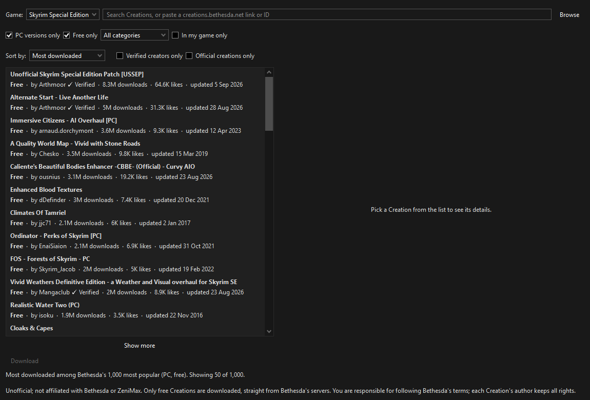
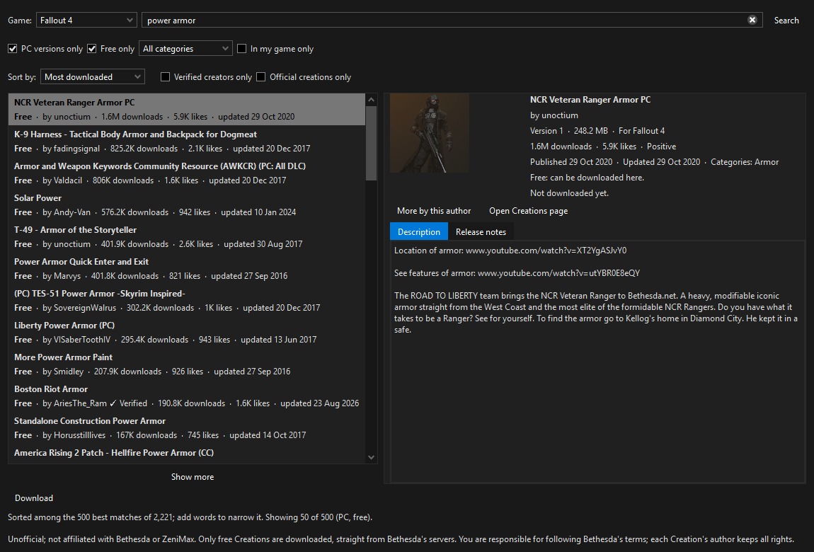
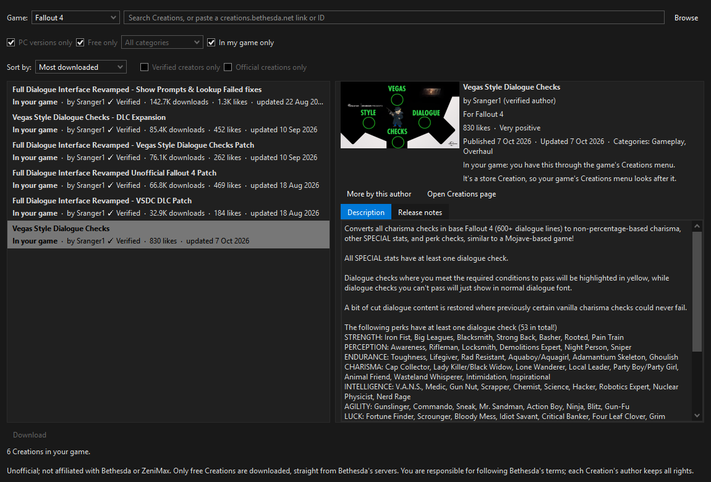

# Creations Browser for Mod Organizer 2

Creations Browser is a plugin for [Mod Organizer 2](https://github.com/ModOrganizer2/modorganizer) (MO2). It lets you
browse Bethesda's Creations for **Fallout 4** and **Skyrim Special Edition** from inside MO2: what each one is, what the
paid ones cost and which ones your game already has. The **free** ones you can download as ordinary downloads, which MO2
installs like any other mod.

**Unofficial. Not affiliated with Bethesda or ZeniMax.** Only free Creations are downloaded, straight from Bethesda's servers.
You are responsible for following Bethesda's terms; each Creation's author keeps all rights.

**Opens on what's popular** (shown: Skyrim Special Edition). The most downloaded Creations for your game, each row
showing whether it's free, its author (✓ Verified for Bethesda's Verified Creators), downloads, likes and last update.
Above the list: the search box, the PC, Free, category and In my game filters, the sort order and the Verified and
Official filters.

**Search, sort and read before you download** (shown: Fallout 4). A search for "power armor" sorted by most downloaded.
Picking a Creation shows its picture, version, size, downloads, likes, rating, dates and categories, its full description
and release notes, and links to its author's other Creations and its Creations page. It's free, so **Download** is ready.

**See what you already have** (shown: Fallout 4). In my game only lists the Creations your game downloaded through its
own Creations menu, paid ones included, each marked **In your game**. The selected one is a paid Creation: the plugin
shows it, and leaves it to the game's Creations menu rather than downloading it.

Everything works the same in both games. Screenshots: MO2 2.5.2 with its "1809 Dark Mode" theme.

## What it does

- Opens on a list: the most downloaded free Creations for your game, so there is something to look at straight away.
- Searches Bethesda's public Creations catalogue (the same one creations.bethesda.net uses) for the game you pick, or
  browses all of it when you leave the search box empty.
- Filters the list: **PC versions only** (leaves out console-only Creations), **Free only** (leaves out Bethesda's store
  items), **Verified creators only** (only Creations by Bethesda's Verified Creators), **Official creations only** (only
  Creations published by Bethesda) and a **category** picker. PC and Free are on by default; the other two are off.
- Sorts the list by most downloaded, trending this week, popular this month, most popular (all time), most liked, best
  rated, newest, recently updated or title (and best match when you search with words). **Most downloaded** counts total
  downloads on all platforms. The three popularity choices are Bethesda's own and are only available without search words.
- Shows total downloads (all platforms), likes and the last update on each row (with a small "✓ Verified" or "✓ Official" after
  the author's name when the author has that mark), and PC downloads, all-platform downloads,
  likes, a rating word, the published and updated dates and the categories in the details.
- Lists the same author's Creations with **More by this author**. The list includes the Creation you are looking at.
- Shows each Creation's title, author, version, size, description, release notes, required DLC and required Creations,
  and a preview picture, with a link to its page on creations.bethesda.net.
- Marks every result clearly: **Free**, or, for Creations in Bethesda's in-game store, their **price in Creation Credits**
  (for example "400 credits", or "Claim in game (free)" for store items you claim at no cost), or **Get it in game** (not clearly
  marked free, or withdrawn); a Creation your game already lists says **In your game** instead. Only free Creations can be
  downloaded here; store Creations are bought or claimed in the game.
- Downloads the PC file of a free Creation, checks it against the size and checksum Bethesda lists, and writes it to your
  MO2 **Downloads** folder as a plain `.zip` (with the small `.meta` file MO2 keeps beside every download).
- Offers "Download these too" when a Creation needs other free Creations you do not have yet.
- Shows whether a Creation is already in your Downloads folder (**Downloaded**, **Installed** or **Update available**).
- Marks the Creations your game has already downloaded through its own Creations menu as **In your game** (in the list and the
  details), and **In my game only** shows just those, free or paid, which is a quick way to see what you have.

## What it never does

- It never logs in, and it never stores a Bethesda account, password or token.
- It never downloads anything paid or anything that is not clearly free, including paid Creations you own: your game's
  Creations menu already has those.
- It never installs anything for you: it only puts a zip in Downloads. You install it from MO2's Downloads tab as usual,
  and MO2 stays in charge of your mod list, load order and profiles.
- It only accepts game data (plugins, archives, textures, meshes, sounds, strings and similar, all under `Data`).
  Programs, scripts that run outside the game and files outside `Data` are refused, and nothing is saved.
- It never redistributes: nothing is bundled or mirrored. Every file comes from Bethesda's own servers to your own PC.
- It never runs in the background. Nothing is contacted until you open its window (which loads the most downloaded Creations),
  and after that only when you search, change the game, a filter or the sort, open the category list, pick a Creation or press
  Download.
  It downloads one file at a time, and its list requests go one after the other.
- Bethesda's signed download links and the public catalogue key are never shown, saved or logged.

## What it sends

Your search words and filters, the sort you pick, the id of the Creation you open, and a user agent naming this plugin and
its version, to Bethesda's servers only. Opening the window asks for the game's category list and the first thousand
Creations in Bethesda's popularity order (ten requests of 100, one after the other); a search with words reads up to 500
matches (five requests). What it has read is kept while the window lives, so going back to a list you have already seen asks
nothing again. The **Verified** and **Official** filters are applied on your PC to what was read. The **In my game only** view
sends the ids of the Creations your game lists (up to 300, at most 100 per request) to Bethesda to fetch their details. No
account, no identifiers, no telemetry, and nothing to anyone else.

## What it reads on your PC

Read only, and never changed:

- Mod Organizer 2's **Downloads** folder and the small `.meta` files beside the downloads (to show **Downloaded**, **Installed**
  or **Update available**, and to reuse a download you already have).
- The game's own list of the Creations it has downloaded, `ContentCatalog.txt`, in your local app data folder
  (`%LOCALAPPDATA%\Fallout4`, or `%LOCALAPPDATA%\Skyrim Special Edition` and its GOG and Epic variants). It is read again
  each time you open the window or change the game. Only its list of Creations is used, and at most the first 5 MB is read.

## Supported games

**Fallout 4** and **Skyrim Special Edition** (including the Anniversary Edition's Creations).

**Starfield is not supported, and won't be.** Bethesda offers Starfield's Creations only through the game's own in-game
menu, which works with your Bethesda account. They aren't on Bethesda's public Creations website, and that website is
the only thing this plugin uses. Reaching Starfield's Creations would mean imitating the game's store and signing in to
your account, and Creations Browser never does either.

## Install

1. Close Mod Organizer 2.
2. From the release zip, copy the `creations_browser` folder (it is inside `plugins`) into the `plugins` folder of your MO2
   installation, so you end up with `...\Mod Organizer 2\plugins\creations_browser\__init__.py`.
3. Start MO2.

Don't install the zip as a mod from MO2's Downloads tab: the plugin goes in MO2's own `plugins` folder.

It needs Mod Organizer 2.5.2 or newer (tested on 2.5.2). MO2 ships Python and PyQt6 itself; there is nothing else to install.

## Use

1. In MO2 open **Tools > Creations Browser**. The window stays open while you use MO2.
2. The window opens on the most downloaded free Creations for your game. Pick the game (it starts on the game your MO2
   instance manages; choosing the other game opens its list at once), then type what you are looking for and press Enter.
   Leave the box empty and press **Browse** to see the list again. You can also paste a creations.bethesda.net link, a Creation id or its UUID.
3. Narrow the list with **PC versions only**, **Free only**, **Verified creators only**, **Official creations only** and the
   category picker, and choose how it is sorted with **Sort by**. Changing a filter or the sort runs the search again after a
   short pause, so stepping through a list is one search. Lists you have already seen come back at once, and changing between
   **Most downloaded** and **Most liked**, or switching the Verified / Official filters, just re-orders what is already there.
   - **Most downloaded** and **Most liked** (the default is Most downloaded): Bethesda has no such sorts, so Creations Browser
     reads the 1,000 most popular Creations (at most ten requests, one after the other; the status line shows the progress),
     sorts them itself and shows 50 at a time. They are the most downloaded *among Bethesda's most popular*: Bethesda's
     popularity order is only a rough guide to downloads, so a very popular Creation can sit outside that thousand.
   - **Trending this week**, **Popular this month** and **Most popular (all time)** are Bethesda's own popularity sorts. With the
     other server sorts (best rated, newest, recently updated, title) they are shown 50 at a time; press **Show more** for the
     next 50. Bethesda ignores sorting when there are search words, so the three popularity choices are greyed out then.
   - With search words, Creations Browser reads up to the 500 best matches (at most five requests) and sorts them itself, so
     changing the sort is instant. If there are more than 500 matches the status line says so; add words to narrow it.
     Bethesda's own sort is ignored by its catalogue whenever there are search words, which is why this is done here.
   - **Verified creators only** and **Official creations only** are not filters Bethesda offers, so they are applied here: with
     either on, a browse reads up to 1,000 Creations (in the order of the sort you picked) and keeps those whose author has
     the mark; a search with words filters its 500 matches.
4. Pick a result to see its details. Press **Download** (free Creations only).
5. When it says "Saved to Downloads", open MO2's **Downloads** tab and install it from there.

**In my game only** (next to the category picker, off by default) shows exactly the Creations your game has downloaded through
its Creations menu, read from the game's own list on your PC and looked up on Bethesda's servers (at most 300, in at most three
requests), whether they are free or paid. PC versions only, Free only, the category and the creator filters are greyed out
while it is on; search words filter the list by title and every sort works on it, all on your PC. Creations your game lists
are marked **In your game** everywhere, and a free one can still be downloaded here. Its limit: it shows what your game has
downloaded through its Creations menu; a Creation you own but never downloaded in game can't be seen without logging in, which
this plugin never does.

Downloading is available only for the game your MO2 instance manages (the Downloads folder belongs to that game). The other
game can still be browsed. Closing the window during a download cancels it and removes the partial file.

### Turning it off

Use MO2's own switch: **Settings > Plugins**, find **Creations Browser** and untick **enabled**. A disabled plugin is removed
from the Tools menu and starts nothing. To remove it completely, delete the `creations_browser` folder from `plugins`.

## Troubleshooting

- **No "Creations Browser" in the Tools menu:** check the folder is `plugins\creations_browser\__init__.py` (not one folder deeper),
  that MO2 was restarted, and that the plugin is enabled under Settings > Plugins. MO2's log (the panel at the bottom, or
  `logs\mo_interface.log`) names the problem if it failed to load.
- **"Couldn't reach Bethesda's servers":** check your internet connection (and any firewall or proxy), then try again.
- **"Bethesda's service didn't answer as expected":** Bethesda's service may be down or may have changed. Try again later;
  if it keeps happening, report it (see below).
- **A download is refused:** the status line names the file that isn't plain game data. Report it with the Creation's link.
- **Download is greyed out:** the Creation is not free ("Get it in game"), has been withdrawn, has no PC download, or the game you
  picked is not the game your MO2 instance manages. The note under the buttons says which.
- **"The downloaded file didn't match":** the download was damaged or changed on the way; nothing was saved. Try again.
- **A file with that name already exists:** a different file with the same name is already in Downloads. Creations Browser
  never overwrites; move or rename the old file and try again.
- Where is it saved? In the Downloads folder MO2 is set to use (Settings > Paths), as
  `<title> (Creation <id>) v<version>.zip` plus a `.meta` file.
- **The Downloads tab shows "ID -1":** that is MO2's way of saying "not a Nexus file". Creations aren't on Nexus, so
  MO2 doesn't check Nexus for updates to them or link them to a Nexus page.

## Reporting problems

Please open an issue at https://github.com/sayngwyn/creations-browser/issues. Say which game, which Creation (its creations.bethesda.net
link is ideal), what you did and what the status line said. Do not include anything from MO2's log that you would not want
to be public.

Tested live in Mod Organizer 2.5.2 with Fallout 4 and Skyrim Special Edition.

## How it was made

Creations Browser was written with an AI assistant, Anthropic's Claude, under my direction. I decided what it should do
and how it should behave, and checked it. The AI wrote most of the code, its 500-plus automated tests and these docs. It
was also tested live in a real Mod Organizer 2 with both games before release.

## Licence

MIT. See `LICENSE`. Creations themselves are not covered by it: each Creation belongs to its author and is subject to
Bethesda's terms.

Bethesda, Creations, Fallout and The Elder Scrolls are trademarks of ZeniMax Media Inc. This project is not endorsed by
them.
