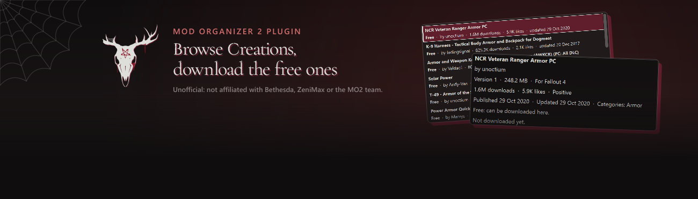

<p align="center">

</p>

Browse Bethesda's Creations for **Fallout 4** and **Skyrim Special Edition** without leaving
[Mod Organizer 2](https://github.com/ModOrganizer2/modorganizer) (MO2), and download the **free** ones as ordinary MO2
downloads.

<p align="center"><picture>
  <source media="(prefers-color-scheme: dark)" srcset="docs/divider.png">
  
</picture></p>

## How it works

- **Open it.** In Mod Organizer 2, open **Tools › Creations Browser**. It opens on the most downloaded Creations for your game.
- **Pick a free Creation.** Search, filter, or paste a Creations link, then press **Download**.
- **Install it as usual.** It lands in MO2's **Downloads** tab, ready to install like any other mod.

<p align="center"></p>

## What you get

- **The best stuff first.** Sort by most downloaded, trending this week, newest, most liked and more.
- **Easy to find.** Search by name, pick a category, or paste a Creations link.
- **Know before you download.** Description, version, size, release notes and what it needs, plus a link to its Creations page.
- **See what you already have.** Creations your game downloaded are marked *In your game*, and paid ones show their price in Creation Credits.

<p align="center"></p>

## Install

1. Close Mod Organizer 2.
2. From the release zip, copy the `creations_browser` folder (it's inside `plugins`) into your MO2's `plugins` folder, so
   you end up with `...\Mod Organizer 2\plugins\creations_browser\__init__.py`.
3. Start MO2.

It needs Mod Organizer 2.5.2 or newer and nothing else: MO2 brings its own Python and PyQt6. It's a plugin for MO2 itself,
so don't install the zip as a mod from the Downloads tab.

## Choose what it does

- **Theme**, at the top right of the window: **sayngwyn** (the default), **Light**, **Dark**, or **Match MO2**, which follows
  your MO2 theme.
- **Filters and sort order** sit right above the list: PC versions, free only, category, verified creators, official
  creations, and **In my game only**.
- **Switch it off** by unticking **Creations Browser** under **Settings › Plugins**. To remove it, delete the
  `creations_browser` folder from `plugins`.

<p align="center"></p>

## Good to know

- **Only free Creations are downloaded, straight from Bethesda's servers.** You are responsible for following Bethesda's
  terms, and each Creation's author keeps all rights.
- Paid ones show their price, and paid ones you own stay with the game's Creations menu, which already has them.
- Every file comes straight from Bethesda's servers to your PC, checked against Bethesda's size and checksum. Only game
  data is accepted: programs, outside scripts and files outside `Data` are refused.
- It never asks for your Bethesda account, and nothing runs in the background.
- It never installs anything for you: it puts a zip in Downloads, and MO2 stays in charge of your mods and load order.
- Downloads go to the game your MO2 instance manages; you can still browse the other game.
- If Bethesda changes its service, the plugin may need an update.
- **Starfield isn't supported, and won't be.** Its Creations are only in the game's own menu, tied to your Bethesda
  account, not on the public Creations website this plugin uses. Reaching them would mean imitating the game's store and
  signing in, which Creations Browser never does.

<details><summary>What it sends, and what it reads on your PC</summary>

**Sent, to Bethesda's servers only:** your search words and filters, the sort you pick, the id of the Creation you open,
and a user agent naming this plugin and its version. Opening the window asks for the game's category list and the first
thousand Creations in Bethesda's popularity order (ten requests of 100, one after the other); a search with words reads
up to 500 matches (five requests). What it has read is kept while the window is open, so going back to a list you've
seen asks nothing again. **In my game only** sends the ids of the Creations your game lists (up to 300, at most 100 per
request) to fetch their details. No account, no identifiers, no telemetry, and nothing to anyone else. It downloads one
file at a time, and Bethesda's signed download links and the public catalogue key are never shown, saved or logged.

**Read on your PC, never changed:**
- MO2's **Downloads** folder and the small `.meta` files beside the downloads, to show **Downloaded**, **Installed** or
  **Update available**, and to reuse a download you already have.
- The game's own list of the Creations it has downloaded, `ContentCatalog.txt`, in your local app data folder
  (`%LOCALAPPDATA%\Fallout4`, or `%LOCALAPPDATA%\Skyrim Special Edition` and its GOG and Epic variants). Only its list of
  Creations is used, and at most the first 5 MB is read.

</details>

<details><summary>More about sorting and In my game only</summary>

- **Most downloaded** and **Most liked** aren't sorts Bethesda offers, so Creations Browser reads Bethesda's 1,000 most
  popular Creations (the status line shows the progress), sorts them itself and shows 50 at a time. They're the most
  downloaded *among Bethesda's most popular*, so a very popular Creation can sit outside that thousand.
- **Trending this week**, **Popular this month** and **Most popular (all time)** are Bethesda's own sorts, available
  without search words. With search words, it reads up to the 500 best matches and sorts them here; if there are more,
  the status line says so.
- **Verified creators only** and **Official creations only** are applied here, to what was read.
- **In my game only** shows exactly the Creations your game downloaded through its Creations menu, free or paid. A
  Creation you own but never downloaded in game can't be seen without logging in, which this plugin never does.
- Closing the window during a download cancels it and removes the partial file. Files are saved as
  `<title> (Creation <id>) v<version>.zip` with a `.meta` file, in the Downloads folder MO2 is set to use.

</details>

<details><summary>Troubleshooting</summary>

- **No "Creations Browser" in the Tools menu:** check the folder is `plugins\creations_browser\__init__.py` (not one
  folder deeper), that MO2 was restarted, and that the plugin is enabled under Settings › Plugins. MO2's log names the
  problem if it failed to load.
- **"Couldn't reach Bethesda's servers":** check your internet connection (and any firewall or proxy), then try again.
- **"Bethesda's service didn't answer as expected":** it may be down or may have changed. Try again later; if it keeps
  happening, report it.
- **Download is greyed out:** the Creation isn't free, has been withdrawn, has no PC download, or the game you picked
  isn't the one your MO2 instance manages. The note under the buttons says which.
- **A download is refused, or "The downloaded file didn't match":** nothing was saved. Try again, and report it with the
  Creation's link if it keeps happening.
- **A file with that name already exists:** Creations Browser never overwrites; move or rename the old file.
- **The Downloads tab shows "ID -1":** that's MO2's way of saying "not a Nexus file". Creations aren't on Nexus, so MO2
  doesn't check Nexus for updates to them.

</details>

<details><summary>Build it yourself</summary>

The plugin is plain Python in `src\creations_browser\`; MO2 runs it as it is. For development, with Python 3.12:

```
py -3.12 -m venv .venv
.venv\Scripts\python.exe -m pip install -r requirements-dev.txt
.venv\Scripts\python.exe -m pytest -q
```

The tests use a fake network, so they never contact Bethesda. `scripts\build_release.py` builds the release zip.

</details>

## Report a problem

Open an issue at https://github.com/sayngwyn/creations-browser/issues, or find me on
[Discord](https://discord.gg/QZHymBYMxP). Say which game, which Creation (its creations.bethesda.net link is ideal), what
you did and what the status line said. Don't include anything from MO2's log you wouldn't want to be public.

## More by sayngwyn

- **[Hide Buttons](https://www.nexusmods.com/site/mods/1619)**: Hide the MO2 buttons you never use. ([source](https://github.com/sayngwyn/hide-buttons))
- **[Modlist Companion](https://www.nexusmods.com/site/mods/2491)**: Remembers every FOMOD choice you made in MO2. ([source](https://github.com/sayngwyn/modlist-companion))
- **[Sayngwyn Theme](https://www.nexusmods.com/site/mods/2487)**: My personal dark theme for MO2. ([source](https://github.com/sayngwyn/sayngwyn-theme))

All my mods: [Nexus](https://www.nexusmods.com/profile/sayngwyn/mods) · [Website](https://sayngwyn.com/projects)

---

Made with AI. Claude contributed heavily under my direction: I decided what it does and checked it, and the AI wrote most
of the code, its tests and these docs. It's tested by 500-plus automated tests and live in a real Mod Organizer 2 with both
games.

## Licence

MIT; see `LICENSE`. Creations themselves aren't covered by it: each Creation belongs to its author and is subject to
Bethesda's terms.

Two kinds of file in `src\creations_browser\assets\` aren't under the MIT licence:
- **Sayngwyn Serif** (`SayngwynSerif-Regular.ttf`) is under the SIL Open Font License 1.1; see `OFL.txt` beside it.
- **The sayngwyn skull mark** (`sayngwyn-mark.png`) is © sayngwyn, all rights reserved. It is not covered by this
  project's MIT licence and is included only for this program's window. Forks must remove or replace it.

*Unofficial. Not affiliated with or endorsed by Bethesda, ZeniMax or the Mod Organizer 2 team. Bethesda, Creations,
Fallout and The Elder Scrolls are trademarks of ZeniMax Media Inc.*
